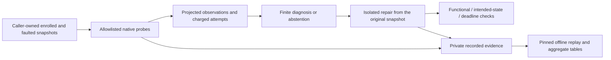

# Verified foundations for evidence-grounded ML diagnosis

The diagnosis work separates intervention fidelity, observable consequence,
evidence adequacy, claim warrant and recovery. These are different questions;
one successful check cannot silently stand in for another. The retained studies
are controlled local experiments and an offline measurement audit, not a claim
of natural-deployment causal accuracy or a new selection algorithm.

## Three connected studies

| Study | Question and evidence | Supported finding | Boundary |
| --- | --- | --- | --- |
| [Ground-truth validity](p2-ground-truth-validity.md) | Check applied state, paired loss, sham/repair and observation-compatible rivals. 35 development cells; 80 Wine–Digits transfer cells. | Twenty harmful transfer cells have successful repair but remain ambiguous from prediction alone. Configured lineage separates the checked rivals. | Finite declared catalogue, small public sources; no new admission of historical benchmark cases. |
| [Comparison robustness](diagnosis-comparison-robustness.md) | Rebuild the unchanged cached evaluation, human-reference design and family-level contrasts. | Label agreement alone does not protect the paired comparison; 198 of 636 core claims have observed references and 438 do not. The conditional primary region includes both signs. | Warrant relative to supplied evidence, not hidden-cause accuracy. The region is not a confidence interval or an unconditional truth bound. |
| [Executed active diagnosis](active-diagnosis-study.md) | Actual state probes, finite selection and isolated repair branches. 200 development opportunities and 800 transfer opportunities over 40 transfer worlds. | Ordinary acquisition resolves the checked catalogue; existing IG/EC² reduce probe calls in finite comparisons. Functional recovery can leave intended state unrecovered. | Dependent opportunities, not 800 incidents. No supported LLM coverage gain or held-out LLM efficacy. |

The thesis claim is the executable separation of these boundaries and the
counterexamples showing why they matter. A restored prediction is not evidence
of a unique cause. A supported claim is not a certificate that its hidden cause
is correct. A singleton in a catalogue is not evidence that the catalogue is
exhaustive.

## Architecture and trust boundaries



Evaluator reference, realized fixture identity and raw proof are kept outside
the selector payload. The declared hypothesis/response model is visible. All
selectors use the same allowlisted executor and declared resources. Model output
cannot grant new tool rights, choose arbitrary paths or execute code.

The replay is a second calculation over retained observations, not a second
independent observation channel. It cannot establish hostile-host completeness,
remeasure historical latency or promote an unknown cause to a verified one.
Earlier numerical reconstruction remains distinct from aggregate replay and
from a future reproduction execution.

## Operation-to-claim map

| Operation or check | Required premise/evidence | Failure or unknown that must remain visible | Permitted conclusion |
| --- | --- | --- | --- |
| Apply intervention | Actual intended state change and binding to the checked execution | Not applied or wrong state | Fidelity in this controlled execution |
| Establish consequence | Paired loss contrast, declared harm gate and sham | No harmful effect, failed measurement | Measured consequence, not unique cause |
| Identify origin | Authorized observations plus explicit rival/response catalogue | Multiple rivals, unavailable probes, outside-model or alias | Identification relative to that catalogue |
| Grade a claim | Exact visible evidence, claim segmentation and reference rules | Unsupported, contradicted, missing reference or operational failure | Warrant relative to that evidence |
| Execute repair | Selected allowlisted action, original immutable branch and charged attempt | Not attempted, failed, late or compensating action | Observed functional and state recovery separately |
| Rebuild tables | Trusted input byte pin, complete census and retained proof/grade accounting | Changed bytes, missing/duplicate cells or inconsistent success flags | Saved-record consistency, not new validation samples |

Default logs are not assumed to contain the configured lineage or clean
enrollment used in the experiments. Evidence-rights and completeness assumptions
must accompany every deployment interpretation.

## Resource and result interpretation

Counts retain their actual units: source, split, native world, opportunity,
request, atomic claim and family. Policies on the same world are paired, not
independent observations. Qualification failures remain in the offered census;
unexecuted model slots do not become successful abstentions or observed errors.

Native attempts include failed final repairs. Selector errors are retained but
are not native probe calls. Acquisition, selection, final decision and repair
contribute to the episode deadline; nested timers are not summed again into
elapsed wall time. Footprint counters describe declared operands, not all
solver traffic or RSS. Setup and local-model startup/resources are reported
separately. These studies do not estimate serving overhead.

The local model development retained 32 planned slots, 29 executions and three
unexecuted slots at its global cap. Its 13 executed LLM/hybrid slots matched
their ordinary comparisons. No new model inference is needed to preserve or
rebuild that negative result.

## Reproduction and verification

Public unit/integration tests use synthetic artifacts or small engineering
checks. They do not distribute human labels, raw model responses, weights,
private reference keys or the original evidence stores.

With caller-owned private evidence, the existing entrypoints provide three
different operations:

| Operation | Entry point | Effect |
| --- | --- | --- |
| Offline ground-truth tables | `scripts/analyze_p2_ground_truth_validity.py` | Reads saved inputs, checks their census/gates and rebuilds tables; no fits or provider calls. |
| Offline measurement audit | `scripts/diagnosis_comparison_robustness.py` | Rebuilds the locked reference/contrast analysis; aggregate-only private output, no human-label edits. |
| Offline ordinary active-diagnosis replay | `scripts/active_diagnosis_study.py analyze` | Requires a trusted input byte pin, checks census/proof/grade consistency and rebuilds summary; no native/model execution. |

Outputs must be new files outside the checkout. Replay rejects duplicate JSON
members, nonfinite numbers, symlink aliases, over-limit input and inconsistent
records. Long Windows I/O uses the extended drive/UNC namespace; it does not
shorten content identities. A hash derived from an unchecked candidate is not
a trusted reference pin.

Execution commands in the individual guides create new controlled experiments;
they are not necessary to replay the retained study. Original execution source
bindings and raw artifacts stay unchanged when packaging corrections are made.
Code corrected after execution must be identified separately, rather than
resealing an old attempt with the new source hash.

Run the registered engineering checks with the repository environment:

```bash
python scripts/run_test_profile.py contract
python scripts/run_test_profile.py evaluation
python scripts/run_test_profile.py windows-publication
python scripts/run_test_profile.py full
```

Full-project coverage, interpreter compatibility, native Windows and remote CI
are separate verification states. Passing a profile on macOS does not certify
Windows behavior. A new commit does not make the research claims stronger by
itself.

## Product handoff: ready interfaces, pending consumer acceptance

This package does not add an HTTP route, ProductView type or deployment-repair
endpoint. The current product runtime is a deterministic mock with causal
abstention; its reproduction references resolve P3 records, not research
NativeCase proofs. Research evaluator grades cannot be relabeled as product
diagnosis results.

The API/dashboard consumer must preserve the existing service contract:

- Project, snapshot, result and originating-turn scope; citation/graph closure.
- Missing evidence, unknown counts as `null`, abstention and technical failure.
- The runtime's actual mock/live status and the exact saved result used for export.
- Immutable results through refresh/reopen, and source preservation through deletion.

These checks require the actual consumer and its interaction flow. Backend
fixture parity, a saved JSON projection or a screenshot is insufficient.
Controlled repair branches remain research operations; no deployment is modified
and no UI repair authority is introduced by this package.

## Closest mechanisms and contribution limits

[MMD](https://www.jmlr.org/papers/volume13/gretton12a/gretton12a.pdf) requires the
sampling assumptions appropriate to the statistic; failure to reject is not
proof of equality. [Prediction-powered inference](https://arxiv.org/html/2301.09633v4)
and earlier survey difference estimators already use reference residual
correction. Small-sample planning widths do not become confirmatory guarantees.
[EC²](https://arxiv.org/html/1010.3091) already studies finite test selection for
equivalence classes; its guarantees do not automatically extend to a missing
catalogue, uncertain measured costs and a hard deadline.

The retained contribution is methodology, executable checks, bounded transfer
and documented counterexamples for this thesis. It is not a novel kernel,
estimator, active-selection algorithm or proof of universal LLM superiority.
